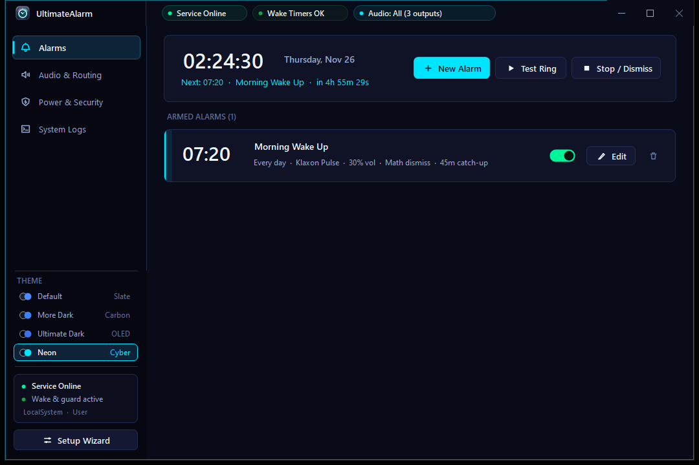
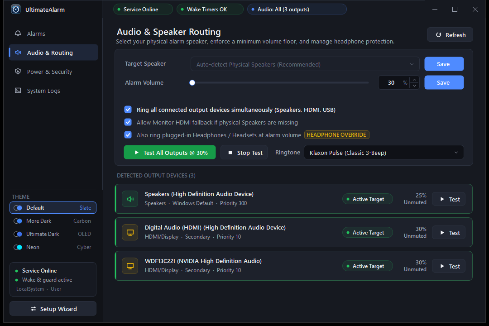
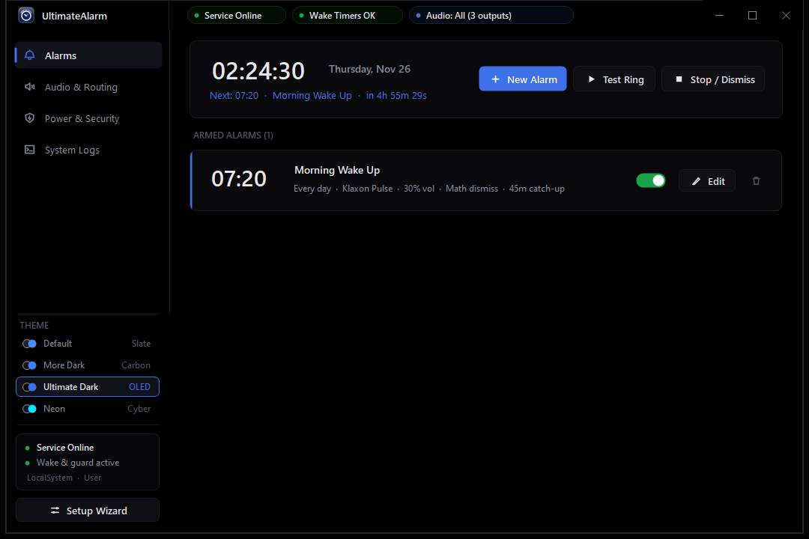
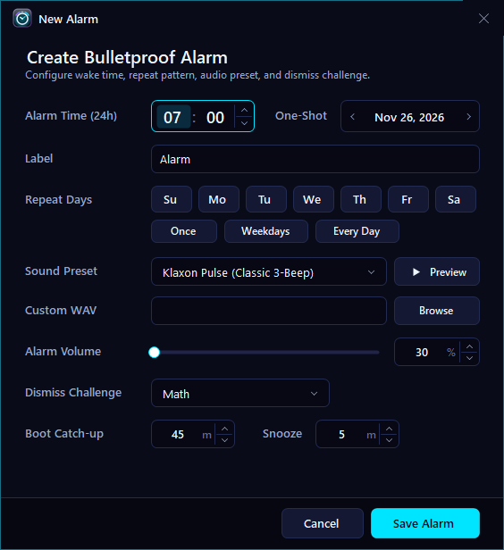

<p align="center">
  
</p>

<h1 align="center">UltimateAlarm</h1>

<p align="center">
  <strong>Bulletproof Windows 10 / 11 Alarm Engine</strong><br/>
  Zero-dependency standalone C#/.NET 4.x executable &bull; LocalSystem Service &bull; Simultaneous Multi-Output WASAPI Audio &bull; Kernel RTC Wake Timers &bull; 4 Live Themes &bull; 11 DSP Ringtones
</p>

<p align="center">
  
  
  
</p>

---

## Overview

**UltimateAlarm** is a lightweight, security-hardened Windows desktop alarm engineered to **never miss an alarm**, **ring simultaneously across all connected speakers and HDMI/USB audio outputs at your enforced volume floor**, **wake your PC from Sleep/Hibernate**, and **ring reliably even at the Windows lock or sign-in screen**.

It compiles with Windows' built-in C# compiler (`csc.exe`) into a **single standalone `UltimateAlarm.exe`** (GUI + Setup Wizard + `LocalSystem` Windows Service + Audio Worker) with **zero external DLLs**, paired with a standalone `ua.exe` command-line tool.

---

## Screenshots

| Neon Theme (`Cyber`) — Dashboard | Default Theme (`Slate`) — Audio & Multi-Output Routing |
|---|---|
|  |  |

| Ultimate Dark (`OLED` `#000000`) | Alarm Editor & Live Ringtone Preview |
|---|---|
|  |  |

---

## Key Features

### 1. Custom Dark-Chrome UI & 4 Live Themes
- **Body-Matched Frameless Dark Title Bar:** Custom Win32 `WM_NCCALCSIZE` / `WM_NCHITTEST` window chrome eliminates Windows 10's stock white title bar while retaining native Aero Snap, drag, resize, and DWM shadows.
- **1-Click Live Theme Switching** (persisted in `alarms.json` and reflected in real time across the title bar, controls, dialogs, and theme-reactive Precision Chronometer icon):
  - **Default (`Slate`)** — Obsidian studio slate with sapphire accent
  - **More Dark (`Carbon`)** — Deeper cold charcoal surfaces
  - **Ultimate Dark (`OLED`)** — Pure `#000000` pitch-black background with `#09090C` stealth cards (zero glare at night)
  - **Neon (`Cyber`)** — Deep void indigo with electric cyan (`#00E5FF`) & neon mint (`#00F59B`) accents

### 2. Simultaneous Multi-Output WASAPI Audio & 11 Built-In DSP Ringtones
- **True Multi-Endpoint Broadcasting:** Plays across **all active physical outputs simultaneously** (Speakers + Monitor HDMI + USB DACs, with optional explicit Headphone override) using parallel MTA WASAPI render threads.
- **Interactive-Session Audio Worker (`WTSQueryUserToken`):** Runs audio playback inside the logged-in user's console session (works unlocked and `Win+L` locked) for full Windows Audio Policy compatibility, falling back automatically to `LocalSystem` at the pre-login Windows sign-in screen.
- **Live Signal Verification & Watchdog:** Verifies active playback on every device via `IAudioClock` + `IAudioMeterInformation` peak metering (logged per device in **System Logs**), automatically falling back to `AUDCLNT_STREAMFLAGS_AUTOCONVERTPCM` or WinMM if a stream stalls.
- **Per-Device `[Test]` Controls & Volume Floor:** Audition all outputs together or test each individual output device directly; enforces `Mute = false` and a configurable **30%–100%** volume floor (with per-alarm overrides).
- **11 Zero-Dependency Synthesized DSP Ringtones (+ Custom Local `.wav`):**
  - `KlaxonPulse` (Classic 3-Beep) &bull; `ClassicTwinBell` (18 Hz Twin-Bell Clock) &bull; `DigitalWatch` (Rapid 4-Chirp)
  - `EmergencySiren` (Dual-Harmonic Sweep) &bull; `NuclearAlert` (Industrial Tritone Horn) &bull; `RadarBeacon` (Air Raid / Radar Sweep)
  - `MilitaryBugle` (Reveille Fanfare) &bull; `CyberNeonPulse` (120 BPM Synthwave Arp) &bull; `SonarPingAlert` (Submarine Sonar)
  - `EscalatingChime` (Bright Harmonic Chime) &bull; `MorningPiano` (Warm Rhodes Arpeggio) &bull; `CustomWav` (Local `.wav`, up to 25 MB)

### 3. Bulletproof Wake, Power & Anti-Disable Protection
- **Kernel RTC Waitable Timers + Redundant Task Backup:** Arms `SetWaitableTimer(..., fResume: true)` plus a hidden `WakeToRun` Task Scheduler trigger (`UltimateAlarmWakeBackup`) to wake from **Sleep (S3 / Modern Standby S0)** and **Hibernate (S4)**.
- **Power Saver & Screen Saver Guard:** Automatically enables AC & DC wake timers across all Windows power plans, disables USB Selective Suspend and HD/HDMI Audio idle power-down, exempts the service & worker from Windows EcoQoS Power Throttling, and wakes DPMS-off displays / dismisses active screen savers when ringing.
- **Task Manager Startup Guard:** Uses `UltimateAlarmService` + a hidden logon scheduled task (`UltimateAlarmTrayLogon`) instead of legacy `HKLM`/`HKCU\Run` keys so optimizers or accidental clicks in Task Manager Startup cannot disable alarms.
- **Boot Catch-Up & Anti-Oversleep Challenges:** Configurable boot catch-up window (default 45m), active ring persistence across unexpected restarts, and CSPRNG **Math**, **TypeCode**, or **PBKDF2 Dismiss PIN** challenges.

### 4. Security-Hardened Architecture
Designed with strict Session 0 (`LocalSystem`) vs. Session 1 (`Standard User`) isolation:
- Admin/SYSTEM-only secure temp XML staging (`CWE-367` / `CWE-377` TOCTOU prevention)
- Absolute `%SystemRoot%\System32` tool pinning + explicit `lpApplicationName` (`CWE-427`)
- Named pipe `NetworkSid` deny, 1 MB cap, async read timeouts & client impersonation checks
- `Synchronize`-only `Global\UltimateAlarmStopEvent` ACL, PBKDF2 hash redaction over IPC & brute-force rate-limiting
- Strict local `.wav` path validation (blocks UNC/SMB NTLM leaks, device paths, and `..` traversal)

See **[SECURITY.md](SECURITY.md)** for the full threat model and CWE-mapped security controls.

---

## Project Structure

```text
Ultimate-Alarm/
├── assets/
│   └── UltimateAlarm.ico       # Multi-size (16–256px) Precision Chronometer icon
├── docs/                       # Logo & UI showcase screenshots
├── src/
│   ├── Common/                 # AssemblyInfo.cs & DPI-aware app.manifest
│   ├── Core/                   # Models, AlarmStore, AudioRouter, PowerWakeManager, SecurityHelper, IpcProtocol, NativeMethods
│   ├── Service/                # AlarmService engine & --service / --audio-worker / --lock-session entry
│   ├── Cli/                    # Standalone ua.exe terminal CLI
│   └── UI/                     # Theme engine, DarkChromeForm, ModernControls, MainForm, Dialogs, SetupWizardForm
├── build.ps1                   # Compiles standalone UltimateAlarm.exe & ua.exe (+ -Package zip)
├── install.ps1                 # Elevated setup launcher
├── Apply-Update.ps1 / .bat     # Safe service stop, binary swap, icon cache refresh & relaunch
├── uninstall.ps1               # Clean service, scheduled task & tray removal
├── Start-UltimateAlarm.bat     # Quick desktop launcher
├── SECURITY.md                 # Security architecture & CWE hardening matrix
└── LICENSE                     # Personal Use Only (Non-Commercial) License
```

---

## Quick Start

### 1. Build from Source (No Visual Studio Required)
Requires Windows 10/11 (x64) with built-in .NET Framework 4.x:
```powershell
git clone https://github.com/Srg719/Ultimate-Alarm.git
cd Ultimate-Alarm
powershell -NoProfile -ExecutionPolicy Bypass -File .\build.ps1 -Clean
```
Outputs:
- `bin\UltimateAlarm.exe` and `dist\UltimateAlarm.exe` — Single standalone executable
- `bin\ua.exe` — Standalone CLI tool
- Add `-Package` to also produce `dist\UltimateAlarm-win-x64.zip`.

### 2. First-Time Setup
Double-click `UltimateAlarm.exe` to run the **4-Step Setup Wizard**, or use the CLI:
```powershell
.\bin\ua.exe setup
```

### 3. Updating a Running Service Installation
After rebuilding from source, run [Apply-Update.bat](Apply-Update.bat) (accept UAC) to safely stop `UltimateAlarmService`, deploy the new executable, refresh Windows shortcuts & icon cache, and relaunch the dashboard.

---

## CLI Reference (`ua.exe`)

| Command | Description |
|---|---|
| `ua setup` | Interactive setup wizard (elevates via UAC if needed) |
| `ua install` / `ua uninstall` | Install or cleanly remove service, wake task & hidden logon task |
| `ua fix-wake` | Harden AC/DC wake timers, USB suspend, audio idle & startup guard |
| `ua status` | Show service status, auth mode, audio routing & armed alarms |
| `ua devices` | List active Windows audio endpoints, categories & scores |
| `ua diag` | Full power, wake timer, screen saver, security & BIOS RTC diagnostics |
| `ua presets` | List all 11 built-in synthesized ringtones |
| `ua theme <Default\|MoreDark\|UltimateDark\|Neon>` | Switch UI theme from the command line |
| `ua add <HH:mm> [--label "..."] [--days daily\|weekdays\|mon,wed\|once] [--sound <preset>] [--wav <local.wav>] [--challenge None\|Math\|TypeCode\|Pin] [--volume 30-100]` | Create and arm a new alarm |
| `ua enable <id>` / `ua disable <id>` / `ua remove <id>` | Toggle or delete an alarm |
| `ua pin-speaker <deviceId\|auto>` | Pin a specific output device or auto-detect physical speakers |
| `ua volume <30-100>` | Set global alarm volume floor (minimum 30%) |
| `ua ring-all <on\|off> [--include-headphones]` | Toggle simultaneous multi-output broadcasting |
| `ua test-ring [seconds] [preset] [--volume 30-100] [--direct]` | Audition any ringtone across target output(s) |
| `ua dismiss` / `ua snooze [minutes]` | Dismiss or snooze an active ring |

---

## Cold Shutdown (S5) Note

Windows software cannot dynamically schedule wake-ups from a full **S5 power-off** because the OS and kernel timers are completely halted. To wake automatically from S5 shutdown:
1. Open the **Power & Security** tab (or run `ua diag`) to read BIOS/UEFI **Power On By RTC** steps tailored to your detected motherboard.
2. Set the BIOS RTC wake time 2–3 minutes before your morning alarm.
3. Keep your Windows password enabled as normal — `UltimateAlarmService` boots as `LocalSystem` before sign-in and fires via the **Boot Catch-up Window**.

---

## Uninstall

```powershell
powershell -NoProfile -ExecutionPolicy Bypass -File .\uninstall.ps1
```
Pass `-RemoveData` to also delete local `data\` and `logs\` directories.

---

## License

Copyright &copy; 2026 [SRG (@Srg719)](https://github.com/Srg719). Licensed under the **Personal Use Only License (Non-Commercial)** — free to view, build, modify, and use strictly for **personal, non-commercial, and educational purposes**. Commercial use, resale, or redistribution as a commercial product is prohibited. See [LICENSE](LICENSE) for full terms.
